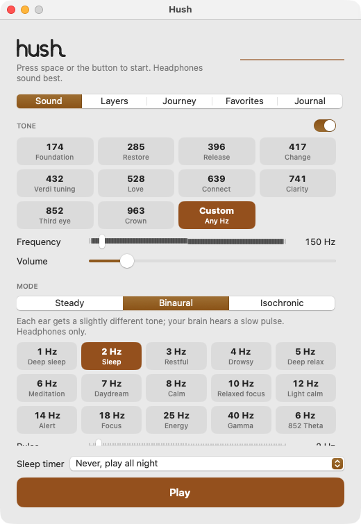

<h1>
  <picture>
    <source media="(prefers-color-scheme: dark)" srcset="brand/hush-wordmark-lamp.svg">
    
  </picture>
</h1>

A native macOS app for calm and sleep. Hush plays pure tones, binaural and isochronic beats, seven colours of noise and five nature sounds. All of it is synthesized live on the audio thread, so nothing loops and it can play cleanly all night.



Built with Swift, SwiftUI and AVAudioEngine. It has no dependencies, needs no network connection and collects no data.

## Features

- **Tones.** A pure sine at any frequency from 100 to 1000 Hz, with presets for the Solfeggio set (174 to 963 Hz) and 432 Hz. The default is 852 Hz.
- **Three tone modes.**
  - Steady: the same tone in both ears.
  - Binaural: a slightly different frequency in each ear, for headphones.
  - Isochronic: the tone pulses on and off, which also works on speakers.
  - There are 15 binaural presets and 5 isochronic presets, from 1 Hz to 40 Hz.
- **Noise.** Brown, pink, white, green, blue, violet and grey noise. All seven are level-matched, so switching colour does not change the loudness.
- **Nature sounds.** Rain, ocean waves, wind, fireplace and stream. They are generated procedurally from filtered noise, and you can layer as many as you like.
- **3D movement.** Noise and nature sounds sweep slowly from side to side on an equal-power pan, while the tone stays centred.
- **Breathing guide.** The volume swells six times a minute, and an on-screen circle shows when to breathe in and out.
- **Sleep journeys.** The pulse rate steps down in stages, for example from 10 Hz to 6 Hz to 3 Hz. Each stage glides into the next, and you can edit the stages.
- **Sleep timer.** Up to 12 hours. The sound fades slowly over the final stretch (up to 10 minutes), so the stop is never abrupt.
- **Keeps the Mac awake while playing.** The system stays awake, but the display can still sleep.
- **Menu bar control.** Closing the window keeps the sound playing. The menu bar icon gives you play and stop, the timer, your favorites and quit.
- **Favorites and a session journal.** Save any mix. Each session longer than a minute is logged, and you can rate your mood before and after.
- **Light and dark mode.** It follows the system theme.

The tone and preset names (Third eye, Deep sleep and so on) are the traditional Solfeggio and brainwave labels people search for. Hush is not a medical device and makes no health claims.

## How it is built

Real-time audio can crackle, drop out or drift over a long night. These choices are what keep a sleep app from doing that.

- **Nothing on the audio thread allocates or locks.** The UI writes settings into atomics (`SynthParams`), and the render callback only reads them. The working arrays have a fixed size and are filled in place. Even `allCases` is cached, because a synthesized `allCases` builds a new array on every call.
- **Every gain change ramps.**
  - Volume knobs and on/off switches go through a one-pole smoother.
  - Changing the noise colour dips to silence before the filter resets, then comes back.
  - Isochronic pulses use raised-cosine edges, so the beat never clicks.
- **The master fade is a `Double`.** A 10-minute fade moves about 3.5e-8 per sample, which is below `Float` precision near 1.0. With a `Float`, the fade ended about 90 seconds early. A selftest now checks that a 600-second fade lasts 600 seconds.
- **Soft clipping instead of a hard clamp.** Output below 0.7 passes through untouched, so a pure tone stays pure. Only loud peaks are rounded off with `tanh`.
- **The brown noise is a leaky integrator.** The leak keeps it centred for hours instead of drifting into clipping.
- **Output device changes are seamless.** Plugging in headphones rebuilds the engine at the new sample rate. The new engine starts from the old fade level and breathing position, so the sound continues where it was.
- **Saved data survives version changes.** Settings decode field by field, falling back to defaults. Favorites decode one by one, so a single unreadable entry cannot wipe the list. Backups are kept of unreadable favorites and journal data before anything is overwritten.

## Requirements

- macOS 15 or later
- Xcode 16 or later, or a Swift 6 toolchain (the package builds in Swift 5 language mode)

## Build and run

```bash
git clone https://github.com/abiodunosagie/hush.git
cd hush
./scripts/build.sh      # release build, assembles and ad-hoc signs build/Hush.app
open build/Hush.app
```

`swift run` also works for a quick look, but the bundled `.app` is what gets a proper menu bar item and window. Neither `swift run` nor `--selftest` needs signing. The build is ad-hoc signed, so if you copy the `.app` to another Mac, Gatekeeper may ask you to confirm the first launch (right-click, then Open).

The bundle identifier is `com.abiodun.hush`, set in `scripts/build.sh`. Change it there if you ship your own build.

## Tests

The synth is tested offline, with no audio device, by rendering through the real `NoiseSynth`:

```bash
swift build -c release
$(swift build -c release --show-bin-path)/Hush --selftest
```

There are 28 checks. They cover:

- Every noise colour and nature sound is level-matched to brown noise.
- Three hours with every layer at maximum stays under full scale, with no NaN and no DC drift.
- The default tone measures as 852 Hz.
- An isochronic beat at 10 Hz pulses exactly 100 times in 10 seconds, with smooth edges.
- 3D movement keeps the overall loudness constant.
- Rapid colour and mode switching stays clean.
- A 10-minute fade lasts 10 minutes.
- An output device change keeps the fade and the breathing position.
- The journey schedule holds, glides and keeps the last stage.
- Saved settings load correctly, even when written by an older version or containing bad data.

## Project layout

```
Sources/Hush/
  Synth.swift            real-time mixer: tone, noise and ambient layers, swell, fade, soft clip
  DSP.swift              RNG, one-pole and biquad filters, smoothed random
  Noise.swift            seven noise colours
  Ambient.swift          procedural rain, ocean, wind, fire and stream
  AudioEngineHost.swift  AVAudioEngine setup and rebuild on device change
  Player.swift           playback state, sleep timer, journeys, keep-awake
  Settings.swift         settings model, tolerant decoding, favorites storage
  Presets.swift          tone presets, binaural and isochronic presets, brainwave labels
  Journey.swift          journey schedule (pure function, tested)
  Journal.swift          session journal stored as JSON in Application Support
  ContentView.swift      window shell: tabs, sleep timer, play button
  SoundTab.swift, LayersTab.swift, JourneyTab.swift, FavoritesTab.swift, JournalTab.swift   one file per tab
  Visuals.swift          waveform and breathing guide
  Components.swift       shared SwiftUI building blocks
  Brand.swift            logo mark, wordmark and menu bar glyph drawn in code
  HushApp.swift          app entry, menu bar extra, --selftest switch
  SelfTest.swift         offline audio checks
scripts/build.sh         builds and assembles the .app bundle
brand/                   logo masters (SVG), app icon and brand guidelines
```

## Privacy

Hush stores your settings and favorites in UserDefaults, and your journal in `~/Library/Application Support/Hush/journal.json`. Nothing leaves your Mac.

## License

MIT. See [LICENSE](LICENSE).

## Author

Abiodun Osagie, mobile, front-end and full-stack developer.
[Portfolio](https://smithportfolio.smitho.workers.dev) · [GitHub](https://github.com/abiodunosagie) · [LinkedIn](https://linkedin.com/in/osagieabiodun)
